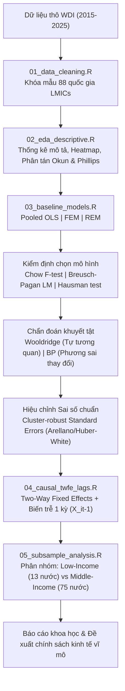

# Phân Tích Các Yếu Tố Kinh Tế Vĩ Mô Liên Quan Đến Tỷ Lệ Thất Nghiệp Tại Các Quốc Gia Thu Nhập Thấp Và Trung Bình

### Tiếp Cận Từ Thực Nghiệm Tương Quan Và Định Hướng Suy Luận Nhân Quả

[](#)
[](#)
[](#)
[](#)
[](LICENSE)

---

## 📌 1. Giới Thiệu Dự Án (Overview)

Kho lưu trữ này chứa toàn bộ mã nguồn kinh tế lượng thực nghiệm, dữ liệu bảng, biểu đồ trực quan hóa và bản thảo công trình Nghiên cứu Khoa học Sinh viên (NCKH 2026 – 2027).

- **Đề tài:** *Phân tích các yếu tố kinh tế vĩ mô liên quan đến tỷ lệ thất nghiệp tại các quốc gia thu nhập thấp và trung bình: Tiếp cận từ thực nghiệm tương quan và định hướng suy luận nhân quả.*
- **Khách thể nghiên cứu:** 88 quốc gia thuộc nhóm Thu nhập thấp và trung bình (Low- and Middle-Income Countries - LMICs) theo phân loại của Ngân hàng Thế giới (World Bank).
- **Phạm vi thời gian:** Giai đoạn 2015 – 2025 (11 năm, dữ liệu bảng cân bằng $N = 88, T = 11, N \times T = 968$ quan sát).
- **Cơ sở dữ liệu trung tâm:** World Development Indicators (WDI) - World Bank.

---

## 💡 2. Tính Cấp Thiết & Câu Hỏi Nghiên Cứu

Giai đoạn 2015–2025 chứng kiến những biến động kinh tế vĩ mô chưa từng có trên quy mô toàn cầu: căng thẳng địa chính trị, tái cấu trúc chuỗi cung ứng, đại dịch COVID-19 và làn sóng lạm phát kỷ lục. Tại khối các quốc gia LMICs, thị trường lao động vốn có tỷ trọng khu vực phi chính thức rất cao và lưới an sinh mỏng manh, thường xuyên đối mặt với **nghịch lý "tăng trưởng không tạo ra việc làm" (jobless growth)**.

Dự án giải quyết 2 khoảng trống lớn trong nghiên cứu thực nghiệm:
1. **Khắc phục giới hạn của mô hình tương quan cổ điển:** Hầu hết các nghiên cứu dừng lại ở Pooled OLS hoặc FEM 1 chiều, chưa xử lý triệt để hiện tượng nội sinh do tác động hai chiều (tăng trưởng GDP kích thích việc làm, nhưng thất nghiệp cũng làm giảm tổng cầu kéo tụt GDP) và tính dai dẳng (*hysteresis*) của thị trường lao động.
2. **Định hướng suy luận nhân quả & Phân tích tính không đồng nhất:** Ứng dụng mô hình Hai chiều Tác động Cố định (**Two-Way Fixed Effects - TWFE**) kiểm soát cả đặc thù quốc gia bất biến theo thời gian và các cú sốc chung theo năm (như COVID-19), kết hợp biến trễ 1 kỳ ($X_{i, t-1}$) và phân tích phân nhóm riêng biệt giữa nước thu nhập thấp (Low-income) và nước thu nhập trung bình (Middle-income).

---

## 📊 3. Hệ Thống Biến Số Nghiên Cứu (Variable Framework)

| Ký hiệu biến | Tên biến học thuật | Chỉ báo trích xuất từ WDI | Đơn vị | Kỳ vọng dấu | Cơ sở lý thuyết |
| :--- | :--- | :--- | :--- | :---: | :--- |
| `Unemployment` | $U_{it}$ *(Biến phụ thuộc)* | Tỷ lệ thất nghiệp (% tổng lực lượng lao động) | % | - | Thước đo sức khỏe thị trường lao động |
| `GDP_growth` | $GDPG_{it}$ | Tốc độ tăng trưởng GDP thực tế hàng năm | %/năm | $(-)$ | Định luật Okun (Okun's Law) |
| `GDP_pc` | $GDPPC_{it}$ | GDP bình quân đầu người | USD | $(-)$ | Trình độ phát triển kinh tế |
| `Inflation` | $INF_{it}$ | Tỷ lệ lạm phát chỉ số giá tiêu dùng CPI | %/năm | $(- / +)$ | Đường cong Phillips ngắn hạn / Bất ổn vĩ mô |
| `FDI` | $FDI_{it}$ | Dòng vốn đầu tư trực tiếp nước ngoài ròng | % GDP | $(-)$ | Chuyển giao công nghệ & mở rộng sản xuất |
| `Trade` | $OPEN_{it}$ | Độ mở thương mại = (Xuất khẩu + Nhập khẩu) / GDP | % GDP | $(-)$ | Lý thuyết Heckscher-Ohlin |
| `Female_LFPR`| $FLFP_{it}$ | Tỷ lệ tham gia lực lượng lao động của nữ giới | % | $(\pm)$ | Cơ cấu nhân khẩu học & bình đẳng giới |
| `Credit_private`| $CREDIT_{it}$ | Tín dụng trong nước cấp cho khu vực tư nhân | % GDP | $(-)$ | Chiều sâu tài chính (Financial Depth) |

---

## 🔬 4. Lộ Trình Phương Pháp Luận Kinh Tế Lượng (Methodology Pipeline)



---

## 📂 5. Cấu Trúc Thư Mục Repository

```
├── .github/                   # Cấu hình GitHub Actions CI & Templates (Issue/PR)
├── Archived Prompts/          # Prompt nguyên bản phục vụ học tập & phân vai (Thánh Nô, Doraemon)
├── data/
│   ├── raw/                   # Dữ liệu gốc World Bank WDI (WDI_RAW_2015_2025.csv)
│   ├── processed/             # Dữ liệu bảng sạch (panel_data_clean.csv, panel_data.RData)
│   └── README.md              # Từ điển dữ liệu và quy chuẩn lọc mẫu
├── Documents/                 # Hồ sơ dự án NCKH (Đề cương, Phân công việc, Nhật ký thánh Nô)
├── notebooks/                 # Notebooks tương tác (RMarkdown / Quarto)
├── reports/
│   ├── drafts/                # Bản thảo 5 chương báo cáo công trình NCKH
│   ├── figures/               # Biểu đồ chất lượng cao (Okun, Phillips, Heatmap, Xu hướng)
│   └── tables/                # Bảng thống kê mô tả, kiểm định và hồi quy
├── scripts/                   # Bộ scripts R chuẩn hóa theo 5 module thực nghiệm
│   ├── 01_data_cleaning.R
│   ├── 02_eda_descriptive.R
│   ├── 03_baseline_models.R
│   ├── 04_causal_twfe_lags.R
│   ├── 05_subsample_analysis.R
│   └── utils/export_helpers.R # Hàm phụ trợ xuất bảng kèm Cluster-robust SE
├── .gitignore                 # Bộ lọc loại bỏ tệp tạm thời
├── AGENTS.md                  # Hướng dẫn chi tiết dành cho AI Agents khi làm việc với repo
├── CITATION.cff               # Định dạng trích dẫn chuẩn khoa học
├── CONTEXT.md                 # Toàn bộ bối cảnh học thuật, cơ sở lý thuyết & kinh tế lượng
├── CONTRIBUTING.md            # Quy chế phối hợp nhóm, phân nhánh Git và quy chuẩn commit
├── install_packages.R         # Cài đặt toàn bộ gói thư viện R cần thiết
├── LICENSE                    # Bản quyền MIT
├── README.md                  # Tài liệu tổng quan (Tệp này)
└── requirements.txt           # Thư viện Python phụ trợ
```

---

## 👥 6. Phân Công Trách Nhiệm Nhóm Nghiên Cứu (12 Tuần)

| Thành viên | Trọng tâm chuyên môn | Phụ trách Scripts | Phụ trách Báo cáo | Bàn giao & Phối hợp |
| :--- | :--- | :--- | :--- | :--- |
| **Thành viên A** | **Dữ liệu, EDA & Cơ sở Lý thuyết** | `01_data_cleaning.R`<br>`02_eda_descriptive.R` | Chương 1, Chương 2, Phần Dữ liệu Chương 3 | Bàn giao dữ liệu bảng sạch và ma trận tương quan cho B (Cuối Tuần 3). |
| **Thành viên B** | **Mô hình cơ sở & Khuyết tật** | `03_baseline_models.R` | Phần Mô hình cơ sở Chương 3, Phân tích cơ sở Chương 4 | Bàn giao mô hình chuẩn và hàm Cluster-robust SE cho C (Cuối Tuần 6). |
| **Thành viên C** | **TWFE biến trễ & Chính sách** | `04_causal_twfe_lags.R`<br>`05_subsample_analysis.R` | Phần TWFE Chương 3, Phân tích nâng cao Chương 4, Toàn bộ Chương 5 | Kế thừa kỹ thuật từ B, đối chiếu lý thuyết từ A để viết kết luận chính sách. |

---

## 🚀 7. Hướng Dẫn Cài Đặt & Tái Lập Nghiên Cứu (Quickstart)

### Bước 1: Clone kho lưu trữ
```bash
git clone https://github.com/tw-vapas/scientific-research-lmic-unemployment.git
cd "scientific-research-lmic-unemployment"
```

### Bước 2: Cài đặt các thư viện R cần thiết
Mở R / RStudio hoặc chạy trên terminal:
```bash
Rscript install_packages.R
```

### Bước 3: Chạy toàn bộ quy trình thực nghiệm (Pipeline)
```bash
# 1. Làm sạch và tạo dữ liệu bảng 88 LMICs
Rscript scripts/01_data_cleaning.R

# 2. Thống kê mô tả và vẽ biểu đồ EDA
Rscript scripts/02_eda_descriptive.R

# 3. Ước lượng mô hình cơ sở & chẩn đoán khuyết tật
Rscript scripts/03_baseline_models.R

# 4. Ước lượng mô hình suy luận nhân quả TWFE với biến trễ
Rscript scripts/04_causal_twfe_lags.R

# 5. Phân tích phân nhóm Low-income vs Middle-income
Rscript scripts/05_subsample_analysis.R
```

Toàn bộ biểu đồ xuất ra sẽ nằm tại `reports/figures/` và bảng kết quả tại `reports/tables/`.

---

## 🤖 8. Quy Chuẩn Tương Tác Dành Cho AI Agents

Kho lưu trữ này được tối ưu hóa đặc biệt để phối hợp nhịp nhàng với các AI Agent (Gemini, Claude, Antigravity). Trước khi thực thi bất kỳ tác vụ nào, AI Agent **BẮT BUỘC** phải đọc kỹ 2 tệp định hướng:
- [CONTEXT.md](CONTEXT.md): Cung cấp toàn bộ bối cảnh học thuật, câu hỏi nghiên cứu, cơ sở dữ liệu và 15 bước kinh tế lượng.
- [AGENTS.md](AGENTS.md): Định vị các chế độ hoạt động (Nhà kinh tế lượng chuẩn mực vs Phương pháp kể chuyện đối thoại Doraemon & Nobita) cùng quy chuẩn code tái lập.

---

## 📜 9. Trích Dẫn & Bản Quyền (Citation & License)

Dự án phát hành dưới giấy phép [MIT License](LICENSE).  
Nếu sử dụng lại dữ liệu hoặc cấu trúc mã nguồn, vui lòng trích dẫn theo tệp [CITATION.cff](CITATION.cff).
